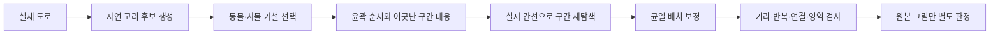

# 관계 가설 기반 경로 생성: 최적화 도달점과 한계

2026-10-21. 실제 도로 재연결 생성기를 구현하고 탐색량·스케줄·균일 배치 보정을 비교했다. **새 개발 6조건의 기하학 정밀 평균은 64.9025 → 74.6354(+9.7330), 개별 최고는 79.7865**였다. 평균 80은 달성하지 못했다. 현재 구현에서 반복을 늘리는 효과는 정체됐지만 전역 최적 상한을 증명한 것은 아니다. 원본 고정 12조건의 77.416667과는 다른 실험이다.

## 구현한 시스템과 검증 범위

`src/lib/route/relationGuidedSearch.ts`의 새 생성기는 경로와 원본 그림의 순환 순서를 대응시키고 실제 도로 노드×진행 단계의 탐색으로 일부 구간을 다시 연결한다. 가까운 몸통 구간으로 바로 건너뛰어 다른 윤곽 구간을 생략하는 지름길을 억제한다. 진행 단계 변경 자체는 좌표나 가짜 간선을 만들지 않는다. 국소 연속 구간의 오차와 기존 특징 커버리지를 관계의 대리 지표로 사용한다.

현재는 **고정 원본 그림 가설을 이용한 기하학적 생성 시제품**이다. 머리·목·몸통을 학습해 검출하는 모델이나 유동적인 LLM 관계 가설 생성까지 완성한 시스템은 아니다. 일부 구간을 전면 수선하는 실제 간선 변경은 구현했고, 해부학적 의미 관계의 인증은 구현하지 않았다. 원본 fit.ts·shapes.ts와 앱의 서버 인식 모델·기본 선택 방식은 바꾸지 않았다.

## 고정 실험 조건

- 지역: 대전 둔산·대구 중심·서울 송파. 과거 사용한 개발지역이며 독립 holdout으로 부르지 않는다. holdout-v2는 읽지 않았다.
- 초기화: seed 20261021, 지역당 400개 면 시작점으로 자연 고리 풀을 새로 생성하고 검증했다. 유효 고유 후보는 총 6,924개다. 저장된 최적 경로를 초기값으로 넣지 않았다.
- 고정 6가설: 대전 새/사과, 대구 거북이/자동차, 송파 새/자동차. 수선 전에 동일 선택기로 확정했으며 결과를 본 뒤 쉬운 가설로 교체하지 않았다.
- 경로·원본 그림은 원래 영역 안, 실제 연결 간선·폐곡선, 원본 간선 길이 및 투영 길이 모두 정확히 3–8km, 반복률 모두 0.2 이하를 유지했다. 반올림 길이를 경계 검사에 사용하지 않았다.
- 후속 예산·혼합·배치 보정 실험은 이 fresh 초기 6경로를 공통 코호트로 재사용했다. 기존 최적 출력 warm-start는 아니지만, 후속 전체 실행을 새 cold 생성이라고 부르지도 않는다.
- 실패는 0점, 모든 평균의 분모는 6이다. 외부 유료 API 호출은 0이다. AI 판정은 같은 모델 계열의 별도 에이전트이며 사람 인식률이 아니다.

## 1. 고정 배치에서 탐색량을 늘린 결과

두 방식 모두 같은 순서 제약 도로 탐색을 사용한다. **균등**은 떨어진 구간을 고르게 방문하고, **관계 우선**은 순서 대응 오차가 큰 구간부터 방문한다. 아래 차이는 가설/관계를 쓰고 안 쓰고의 비교가 아니라 수선 구간을 고르는 스케줄의 비교다.

| 조건당 수선 제안 상한 | 균등 평균 | 관계 우선 평균 |
|---:|---:|---:|
| 0 | 64.9025 | 64.9025 |
| 8 | 65.8591 | 68.2945 |
| 32 | 70.0822 | 70.3687 |
| 96 | 71.9009 | 71.4329 |
| 192 | 73.0533 | 71.7959 |
| 384 | 73.4740 | 73.3811 |
| 1,536 | 73.5352 | 73.3811 |

각 제안의 탐색 확장 상한은 12,000이다. 192/384회에서 확장 상한을 48,000으로 늘린 추가 대조는 같은 경로·같은 점수였고 추가 개선이 없었다. 1,536회는 요청 상한이며, 더 시도할 제안이 없어 실제 시도는 그보다 일찍 끝난 조건도 있다.

관계 우선은 8회처럼 작은 예산에서 유리했으나, 큰 예산에서는 균등보다 일관되게 좋지 않았다. 균등의 384→1,536 증가는 평균 +0.0612점뿐이었다. 이 결과는 현재 국소 구간·제안 가중치·고정 배치에서의 경험적 정체이며 도로 전체의 가능성을 부정하지 않는다.

## 2. 혼합 스케줄과 배치 보정

동일 총 제안 수를 반으로 나눠 균등→관계와 관계→균등을 시험했다. 384회에서 각각 73.5077, 73.1893으로, 단일 균등 73.4740보다 뚜렷한 우위가 없었다. 두 순서 중 조건별 최고를 사후 선택한 합집합을 단일 알고리즘 성능으로 보고하지 않았다.

다음으로 매 라운드에서 실제 도로 수선 64회와 균일 이동·회전·크기 배치 보정 최대 80회를 교대로 수행했다.

| 방식 | 평균 | 개별 최고 | 제안 상한/조건 | 추가 배치 평가 상한/조건 |
|---|---:|---:|---:|---:|
| 초기 경로 | 64.9025 | 72.9785 | 0 | 초기화에 공통 80회 |
| 경로 고정·배치만 반복 보정 | 65.1328 | 별도 대조 | 0 | 480 |
| 균등 수선+배치, 3라운드 | **74.6168** | **79.7865** | 192 | 240 |
| 균등 수선+배치, 6라운드 | **74.6354** | **79.7865** | 384 | 480 |
| 관계 수선+배치, 3라운드 | 73.8501 | 78.5182 | 192 | 240 |
| 관계 수선+배치, 6라운드 | 74.4432 | 78.5182 | 384 | 480 |

배치 보정에는 추가 연산이 있으므로 고정 배치 실험과 동일 총계산 비교가 아니다. 양쪽 수선 스케줄끼리는 같은 상한을 사용했다. 배치만 보정한 대조는 +0.2303점에 그쳤으며, 최종 12개는 모두 실제 도로 간선과 배치가 바뀌었다. 최종 배치를 초기 경로에도 적용해 비교했을 때도 새 실제 경로가 12/12 우수했다.

균등 3→6라운드에서 실제 추가 상승은 **+0.0187점**이었다. 이 개발 코호트에서는 3라운드가 비용 대비 실용적인 중단 지점이며, 6라운드는 더 많은 계산으로 관측한 최고점이다. 앱에 적용할 인식 품질이 확보됐다는 뜻은 아니다.

## 조건별 관측 최고 단일 방식

다음은 가장 높은 평균을 낸 **균등 수선+균일 배치 보정 6라운드 하나의 결과**다. 조건별로 서로 다른 알고리즘의 최고를 합친 값이 아니다.

| 개발 조건 | 초기 | 최종 |
|---|---:|---:|
| 대전 새 | 63.5680 | 67.4749 |
| 대전 사과 | 56.4731 | 71.8062 |
| 대구 거북이 | 63.1818 | **79.7865** |
| 대구 자동차 | 68.7396 | 77.0748 |
| 송파 새 | 64.4738 | 74.3166 |
| 송파 자동차 | 72.9785 | 77.3534 |
| 평균, 실패 포함 분모 6 | **64.9025** | **74.6354** |

다른 일정에서는 대전 사과가 73.7568로 더 높았으나 위 단일 방식 평균에 섞지 않았다. 표시용으로 개별 최고 79.7865를 80으로 반올림해 ‘80 달성’이라고 하지 않는다.

## 3. 시간·유효성·재현 검증

첫 fresh 실행의 세 지역 후보 생성 합은 약 2.36초, 가설 선택 합은 약 11.78초였다. 초기 배치 보정은 별도이며, 이는 서버·도로 다운로드·UI 전체 지연 시간이 아니다.

최종 기록에서 6조건 수선 호출 합은 고정 배치 균등 384회 약 5.93초, 1,536회 약 17.26초였다. 균등+배치 3라운드 약 9.37초, 6라운드 약 16.01초다. 병행 작업이 있는 로컬 실험의 단일 wall 기록이므로 정밀한 속도 우열이나 배포 지연 보장이 아니다. 실제 제안·확장·후보 평가·배치 평가 횟수는 각 JSON에 기록했다. 예산별 재시작 실행들의 시간을 하나의 실시간 파이프라인 지연처럼 합치지 않는다.

별도 감사 에이전트가 **252개 초기/출력 상태와 배치 전용 대조 36개, 총 288상태**를 재계산해 통과했다. 중복 초기 상태가 포함된 수이며 고유 경로 수가 아니다. 실제 간선·폐곡선·영역·원본/투영 길이·반복·정밀 원점수·고정 6조건·동일 초기 경로를 검사했다. 시작점만 바꾼 점수 상승은 실제 경로 개선으로 세지 않았고, 바뀐 간선은 원래 입력 및 표준 시작점 대조보다 실제로 나은지 검사했다. 최종 소스와 스냅샷 해시 불일치는 없었다.

## 4. 원본 인식 성과와 대조군

가장 좋은 두 배치 보정 방식의 6라운드 출력과 초기 경로, 총 18개를 이름·점수·방법을 숨겨 별도 AI에게 자유 명명하도록 했다.

| 원본 북쪽 위 표시 | 초기 | 균등+배치 | 관계+배치 |
|---|---:|---:|---:|
| 명확한 동물·사물 | 0/6 | 0/6 | 0/6 |
| 약한 연상 | 4/6 | 4/6 | 4/6 |
| 없음 | 2/6 | 2/6 | 2/6 |
| 주관 AI 점수 평균 | 31.50 | 32.17 | 33.17 |

**기하학 +9.73점이 명확한 사물 인식 개선으로 이어졌다는 증거는 없었다.** 실제 길의 불필요한 돌출·부분 비율·연결이 여전히 핵심 병목이다. 같은 계열 AI 한 명의 판정이므로 사람의 보편 인식률로 해석할 수 없다.

평가자가 대상 자체를 전혀 알아보지 못하는지 확인하기 위해 도로에 맞추지 않은 원본 참고 윤곽 4개를 별도로 평가했다. 자동차·사과·거북이·새 모두 명확한 인식 판정이었다. 이 대조군은 실제 도로 성과 분모에 넣지 않았다. 원본 참고 윤곽의 점수도 실제 도로 기하 점수와 합치지 않는다.

최종 후보의 회전각은 약 -49°부터 175°까지여서 방향도 혼재된 변수였다. 별도의 같은 계열 AI에게 방향을 정렬한 원본 18개와, 최종 방향으로 회전한 이상적 참고 윤곽 6개를 방법·대상명 없이 제시했다. 정렬한 실제 경로는 초기/균등/관계 모두 **명확한 인식 0/6, 약한 연상 6/6**이었다. 회전한 이상적 참고 윤곽은 4/6이 명확했고 새 2개는 약한 연상이었다. 따라서 방향만 바꿔 문제를 해결했다는 근거도 없다.

이 보조 평가에서는 이상적 참고 윤곽과 실제 경로를 같은 시트 모음에 섞어 보았으므로 이미지에 의한 암시 가능성이 있고, 북쪽 위 평가와 평가자가 달라 주관 점수의 차이를 직접 비교하지 않는다. 실제 경로 인식 0/6이라는 결론이 유지된 점을 확인하는 진단이다. 방향 정렬은 표시 처리로 실제 도로를 바꾸지 않으며 생성 성능 분모에 대조 그림을 추가하지 않았다.

대구 거북이 가설의 초기/최종 원본 예시다. 아래 이름은 탐색 가설이며 평가자가 자유 명명한 정답을 뜻하지 않는다.

## 결론과 적용 판단

현재 구현·초기 경로 6개·정해진 제안 공간에서 **평균 약 74.6, 개별 최고 약 79.8**까지 최적화됨을 확인했다. 더 오래 돌리는 것만으로 80 평균이나 명확한 인식이 확보되지는 않았다. 이 수치는 이론적 상한이 아니다. 새 시작 위치·위상·가설 표현·도로 후보 생성기가 바뀌면 다른 결과가 가능하다.

현재 생성기의 ‘관계’는 윤곽 순서와 국소 오차의 대리 지표다. 다음 개선은 머리/몸통처럼 이름 붙은 부위의 위치·크기·연결을 직접 제약하고, 긴 여분 구간과 부위 폭을 검증하는 표현이 필요하다. 이미 있는 고정 가설을 더 오래 맞추거나 설명 그림을 꾸미는 것만으로 성공으로 처리하지 않는다. 원본 인식의 우위가 확인되지 않아 **앱 기본에는 적용하지 않았다.**

## 산출물과 재현

- 생성기: `src/lib/route/relationGuidedSearch.ts`.
- 단위 검증: `tests/relation-guided-search.test.ts` 5개.
- fresh 예산 곡선: `tests/eval/relation-generation-20261021.test.ts`.
- 1,536회 정체 탐색: `tests/eval/relation-stress-20261021.test.ts`.
- 혼합/교대 최적화: `tests/eval/relation-hybrid-20261021.test.ts`, `relation-cascade-20261021.test.ts`.
- 독립 감사: `tests/eval/relation-generation-audit-20261021.test.ts`.
- 전체 실측 JSON·PNG·원본 코드: Git 제외 `eval/recognition/relation-generation-20261021/`.
- 표 집계: `node scripts/recognition-lab/relation-generation-summary.mjs` → summary.json/performance.csv. 집계 재실행은 새로운 의미 판정을 수행하지 않는다.

PowerShell에서 `RELATION_GENERATION=1` 설정 후 fresh 하네스를 실행한다. `RELATION_LEVELS`는 8,32,96 또는 192,384, `RELATION_MAX_EXPANDED`는 12000 또는 48000이며 각 실행은 서로 다른 `RELATION_RUN` 디렉터리를 사용한다. 후속 실험은 각각 RELATION_STRESS, RELATION_HYBRID, RELATION_CASCADE 환경 플래그를 켜고 해당 테스트를 실행한다. 감사 플래그와 원본 자료 요구는 감사 테스트와 [실행 전 프로토콜](relation-generation-protocol-20261021.md)을 따른다. 이 보고서만으로 Git에서 제외된 도로·실험 원본 전체가 복원되지는 않는다.
