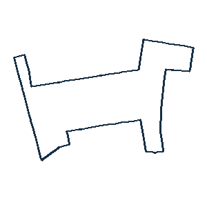

# v16 고정 후보 선택 진단과 실제 사람 확인 사례

**실제 도로 경로1개에 대해 사용자가 이름을 보지 않고 ‘강아지 명확’이라고 답했다.** 이 경로는 기존 생성 풀의4번째 후보였으며5.584km다. 사람이 명확히 읽은 개발 사례를 확보했지만, 사후 선택된1사례이므로 모델 전체 성능 개선이나 최종 목표 달성으로 세지 않는다.

## 사람 확인 경로

- 사용자 원문: **강아지 명확**
- [원본 경로GPX](../../public/eval/road-human-probe-20261103-one/route.gpx)
- 기록: v16-human-response.json. 원래 pixel·manifest SHA에 연결했다.
- source: ulsan-samsan-diversity-v11-dog-4,거리5584.02m,반복0,원래 보조 유사도79. 유사도80을 넘지 않아도 사람 인식 관측은 별도다.

기존 첫 후보는 같은 요청의 dog-1이지만 그 경로를 사람에게 동일 조건으로 비교 평가하지 않았다. 따라서 사람 기준 baseline 실패→새 모델 성공이라는 대조 주장은 하지 않는다. 사용자에게 보여준 것은 완료된 AI 진단에서 찾은 유일한 신규 누락 사례로,무작위 사람 표본이 아닌 사후 선택된 개발 후속 확인이다. 일반적인 프로젝트 사전 노출도 있었다. 앞선3사례(렌치약함·없음·없음)와 묶어 새 성공률을 만들지 않는다.

## 고정 풀 진단

새 geometry나 학습은 하지 않고 원본1003행·75요청을 유지했다. baseline과 같은 간선집합을 제외한 뒤 geometry별 최소ID대표를고르고 sourcegeometry salted-hash순 대안2개를 고정했다. 각75슬롯 중 실제73·67장,총140장이다.2요청은대안없음,8요청은두번째대안없음이다. 부족분은NA이며 이미지에none응답을만들지않았다. 원래 canonical 방향과 좌표·배치·점수를 보존했다.

| AI 대상일치 명확 | baseline | 대안1 | 대안2 | baseline+대안 union |
|---|---:|---:|---:|---:|
| 이미지별3AI 다수결 |8/75|5/75|4/75|9/75|
| 그중 동물 |2/33|0/33|3/33|3/33|
| 고정 primary |0/75|0/75|0/75|0/75|

다수결의 추가 누락 발견은1요청·동물1종,primary는0이다. 사전 기준인추가>=5·동물>=3·2종과원래다양성 gate는 모두 실패다. 여러 그림 중 답을 알고 하나를 택한9/75는 표집 내 관측상 달성가능성 하한이며 자동 top1모델의9/75 성능이 아니다. 사람 인식 하한도 아니다. 기존8/75를 바꾸거나140장 밖의 좋은후보 부재를 주장하지 않는다.

대안2에서 명확한 동물은 물고기·오리·개 각1지역이었다. 물고기와오리 요청은 baseline에도 명확했던 것이어서 추가 누락은개1건뿐이다. 다른 사물로 clear인 해석도 원래 자유이름에 남기며 target정답으로 바꾸지 않았다.

## 25종 분모 보존

| 대상 | 구분 | baseline 명확/3 | 대안1 명확/3 | 대안2 명확/3 | 표집 union/3 |
|---|---|---:|---:|---:|---:|
|고양이|동물|0|0|0|0|
|물고기|동물|1|0|1|1|
|강아지|동물|0|0|1|1|
|토끼|동물|0|0|0|0|
|새|동물|0|0|0|0|
|고래|동물|0|0|0|0|
|거북이|동물|0|0|0|0|
|코끼리|동물|0|0|0|0|
|기린|동물|0|0|0|0|
|나비|동물|0|0|0|0|
|오리|동물|1|0|1|1|
|집|사물|0|0|0|0|
|나무|사물|0|0|0|0|
|자동차|사물|0|0|0|0|
|로켓|사물|0|0|0|0|
|사과|사물|0|0|0|0|
|왕관|사물|0|0|0|0|
|비행기|사물|0|0|0|0|
|컵|사물|0|0|0|0|
|티셔츠|사물|1|1|0|1|
|바지|사물|3|2|1|3|
|망치|사물|1|1|0|1|
|병|사물|0|0|0|0|
|열쇠|사물|0|0|0|0|
|의자|사물|1|1|0|1|

## 무결성과 한계

135개 신규 고유 이미지·기존 동일pixel연결을3평가자별로 보존했다. 이미지별 target투표를 먼저 계산한 뒤 요청union을 구해,서로 다른 이미지의표를 합쳐 가상의 합의를 만들지 않았다. 고정3AI roster/primary를 유지하고명확 기준·동의어·seed를 결과후 바꾸지 않았다. 같은계열AI·이미본3개지역이라는 한계가 있다.

고정 source·selection ordinal1/2·전체행·catalog·mapping·case ID·결측·token·개별rating token을 연결검사했다. 판정 전에고정한 study-lock의파일바이트hash와pageSHA를확인했다. 원래FP를유지한token교체·중복study·다른catalog/ID·잘못된rating을거절하는회귀검사를포함해Python62검사통과.140GPX를 원본좌표와대조했고검토UI의25종필터·빈답·평가자전환·차단저장환경export도확인했다.

[대안1: 이름 없는 사람 검토](../../public/eval/route-study-20261103-f/blind.html) · [대안2: 이름 없는 사람 검토](../../public/eval/route-study-20261103-g/blind.html)

이번진단의카탈로그는v11의동결원본이므로분류기지원설명은그당시metadata이며현재선택에CLIP/head를사용한것이아니다. 새로얻은판정을학습·규칙개발에쓰면이번표본은개발자료가되며,다음모델성능은독립된고정자료/판정으로검증해야한다. 원래12조건·점수식·holdout-v2·앱기본·75분모는보존했다.

## 다음 작업

사람에게읽히는후보가현재첫추천밖에있다는사례1은확인됐다. 하지만선택누락이전체주요병목이라는결론이나초기수준의개발진단을새모델검증으로대체할수없다. 다음은기존실패CNN/손그림head를재검토하고,실제도로판정의geometry그룹누수와소수긍정표본한계를고려한읽힘선택모델의학습/독립검증을사전에고정하는것이다. 이1사례를같은그림의학습과최종성공검증에동시에사용하지않는다.

원본: protocol-v16-pool.md,v16-study-lock.json,v16-pool-results.json,v16-expert-interpretation.md,v16-human-response.json,ai-review-v16-*.json.
