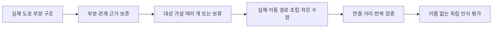

# 도로에서 읽히는 부분을 보존해 드로잉런을 다시 설계한다

조사일: **2026-10-21** · 현재 코드 기준: **`809bbea`** · 실제 작품 조사·알고리즘 설계·비판적 평가 담당 에이전트의 공동 검토

**현재 방식과 실제 창작의 가장 큰 차이는, 대상을 알아보게 하는 부분과 그 관계를 탐색 중에 보존하느냐에 있다.** 실제 작품에는 단순 하트 윤곽도 있지만, 눈과 입의 위치, 꽃과 줄기의 연결, 날개와 몸통의 비례가 의미를 만드는 작품도 있다. 현재 앱은 자연 도로 고리와 기존 도형 맞춤에 강점을 두지만, 새 사물 해석에는 초기 고리 중 최대 세 개만 보내므로 후반 탐색과 의미 발견이 충분히 연결되지 않는다. 그렇다고 템플릿을 버리거나 여러 획을 추가하면 해결된다는 결론은 아니다. 먼저 **같은 후보 풀에서 사람이 알아볼 후보를 놓치는지** 확인하고, 풀이 빈약할 때 실제 도로의 부분 관계를 보존하는 생성기로 넘어가는 것이 합의안이다. 아래는 공개 작품과 코드에서 확인한 사실에 근거한 설계 제안이며, 새 인식 성능·앱 개선·80점 달성을 보고하는 문서가 아니다.

## 실제 작품은 매끈한 선보다 부분의 배치로 읽힌다

연구팀은 창작자 세 명의 러닝 작품 여섯 개를 원본 이미지 또는 공개 활동 화면에서 직접 확인했다. **모두 제목을 먼저 알고 본 관찰**이므로 이름 없는 인식 실험은 아니다. 아래 ‘관찰’은 이미지에서 본 구조이고, 거리·시간과 제작 방식은 창작자 또는 공식 활동의 텍스트다. 이미지에 내부선이 있다는 이유로 같은 길을 왕복했다거나 녹화를 멈췄다고 판정하지 않았다.

| 작품·창작자 | 직접 본 구조와 확인 범위 | 원문·그림 / 공개 거리 |
|---|---|---|
| Death Star · Gene Lu | 큰 외곽에 중앙 수평선, 내부 원·대각선, 주변 작은 TIE 형태 세 개가 결합한다. 단일 원의 닮음만으로 작품 구조를 설명하기 어렵다. | [본인 페이지](https://genelu.com/work/gps-art-running) · [원본 그림](https://images.squarespace-cdn.com/content/v1/5f3bf4c5e6695b7cd72e69e8/1598017873553-OMN2FA50Y1BHOG89HRQY/RunWars_DeathStar_PDX.jpg). 개별 거리 미확인. |
| C-3PO · Gene Lu | 얼굴 외곽 안의 두 눈, 세로선, 입의 위치·비례가 중요해 보인다. | [본인 페이지](https://genelu.com/work/gps-art-running) · [원본 그림](https://images.squarespace-cdn.com/content/v1/5f3bf4c5e6695b7cd72e69e8/1598017873130-S9NWP3CBFGH0TYTOLFFB/RunWars_C3PO_PDX.jpg). 그림에 **17.3mi, 약 27.8km** 표시. |
| Rose Run · Lenny Maughan | 꽃 안의 나선형 꽃잎, 긴 줄기와 양옆 잎이 하나의 구조를 만든다. 도로의 계단 모양이 남아도 부분 관계가 유지된다. | [공식 설명·완성 그림](https://stories.strava.com/ea/articles/love-strava-art-how-to-create-your-masterpiece) · [활동](https://www.strava.com/activities/1598374796) · [그림 embed](https://strava-embeds.com/activity/1598374796?style=standard). Run, **29.5mi, 약 47.5km**, 5시간 19분. |
| Heart Run · Lenny Maughan | 두 둥근 윗부분과 중앙 홈을 직접 확인했다. 캡처 아래가 잘려 아래 꼭짓점 세부는 확정하지 않았다. 단순 윤곽형의 균형 사례다. | [활동](https://www.strava.com/activities/1396716975) · [그림 embed](https://strava-embeds.com/activity/1396716975?style=standard). Run, **23.9mi, 약 38.5km**, 4시간 7분. |
| 愛, Kanji Run · Lenny Maughan | 상단·중앙의 가로획과 내부 꺾임·구획을 확인했다. 아래 전체는 캡처 밖이다. 문자 의미는 바깥 테두리만으로 보존되지 않을 수 있다. | [활동](https://www.strava.com/activities/5517952512) · [그림 embed](https://strava-embeds.com/activity/5517952512?style=standard). 본인 설명은 사랑을 뜻하는 ai. Run, **34.0mi, 약 54.7km**, 6시간 14분. |
| London Dragon Marathon · Jeric Yuen | 큰 날개, 머리·불꽃·발·꼬리의 배치와 몸통 안쪽 선이 보인다. 교차선의 이동 순서는 그림에서 알 수 없다. | [공식 선정 기사](https://stories.strava.com/articles/the-best-strava-art-of-2023) · [활동](https://www.strava.com/activities/8943283545) · [그림 embed](https://strava-embeds.com/activity/8943283545?style=standard). Run, **42.6km**, 3시간 58분. |

이 관찰에서 도출한 **가설**은 ‘곡선을 매끈하게 만드는 것보다 중요한 부분의 상대 위치·비례를 지키는 것이 인식에 도움이 된다’는 것이다. 예를 들어 몸통과 연결되지 않거나 지나치게 큰 꼬리는 꼬리 모양의 선 하나가 있다는 사실만으로 고양이를 만들지 못한다. 반대로 하트처럼 윤곽 자체가 의미인 유형에서는 현재 도형 맞춤을 계속 발전시키는 편이 적절할 수 있다. 여섯 작품은 이런 표현 차이를 보여주지만, 사람 인식률이나 어느 표현이 더 우수한지는 측정하지 않았다.

창작자의 설명도 두 방향을 함께 지지한다. Gene Lu는 스케치에서 상징적인 부분을 먼저 고른 뒤 지도에서 찾고, 거리와 회전을 검토한다고 설명한다. Lenny는 지도에서 모양을 발견하기도 하고 정한 그림을 지도에 맞추기도 하며, 여러 초안과 출발·도착 위치 조정을 통해 불필요한 왕복을 줄인다고 말한다. 따라서 **도로 우선 발견형과 그림 지정형은 둘 다 유지할 가치가 있다.** ([Gene Lu의 제작 과정](https://genelu.com/work/gps-art-running), [Lenny의 공식 Strava 인터뷰](https://stories.strava.com/ea/articles/love-strava-art-how-to-create-your-masterpiece))

비교 조건에는 큰 차이가 있다. 이번 표본에서 원본 GPX·실제 도로 연결·반복률까지 검증한 **3–8km 작품은 확보하지 못했다.** 개별 작품의 녹화 중단·재개 여부도 모른다. Lenny의 인터뷰에는 장애물에서 녹화를 멈추고 우회한 뒤 재개하여 표시선을 직선으로 잇는 방법이 나오지만, 표의 작품에서 실제 사용했다는 증거는 아니다. 공식 선집과 포트폴리오에는 장거리 성공작 선정 편향이 있다. 이를 짧은 동네 자동 추천의 성능 기준으로 직접 옮기면 안 된다. 국내 짧은 연속 러닝 작품은 공개 GPX까지 갖춘 후속 표본 수집이 필요하다. ([제작 인터뷰](https://stories.strava.com/ea/articles/love-strava-art-how-to-create-your-masterpiece), [공식 성공작 선집](https://stories.strava.com/articles/the-best-strava-art-of-2023))

## 현재 병목은 고리 생성과 새 사물 발견의 연결에 있다

확인된 것은 코드의 표현·선별 범위이고, 아직 모르는 것은 그 범위 때문에 좋은 작품을 얼마나 잃는지다. 자연 고리 생성은 블록 면의 합집합 경계를 사용하며 구멍, 한 점 접촉, 같은 교차점 재방문을 제외한다. 이 가지는 단순 외곽을 만들기에는 유용하지만 내부 획·반복 교차가 있는 모든 연속 이동을 표현하지는 않는다. 앱 전체에 교차나 복수 획 기능이 전혀 없다는 뜻은 아니다. 이미 가지 왕복, 여러 폐곡선 획과 연결 이동, 윤곽 진행 순서 탐색이 있다. ([고리 생성](</C:/Users/ekdus/OneDrive/바탕 화면/running/src/lib/route/loops.ts:181>), [가지](</C:/Users/ekdus/OneDrive/바탕 화면/running/src/lib/route/branches.ts:117>), [여러 획](</C:/Users/ekdus/OneDrive/바탕 화면/running/src/lib/route/group.ts:151>))

| 비교 축 | 실제 작품·제작 설명에서 확인한 점 | 현재 구조와의 괴리·검증할 가설 |
|---|---|---|
| 전체 윤곽과 부분 관계 | 단순 하트도 있고, 눈·잎·날개의 배치가 중요한 그림도 있다. | 윤곽 거리와 특징점 접근은 있지만, 중요한 부분의 위치·비례를 탐색 중 보존하는지가 부족할 수 있다. |
| 그림과 실제 이동 | 내부선·교차가 보이며 작가는 왕복도 계획한다. 개별 이동 순서는 미확인이다. | 단순 면 경계와, 고리+내부선 전체를 방문하는 실제 이동 경로는 서로 다른 표현이다. |
| 계산 배정과 AI 입력 | 사람은 핵심 부분을 찾고 전체 배치를 반복 수정한다. | 일반 발견은 로컬 시간 **30% 고리 발견·70% 기존 도형 개선**이다. 외부 AI는 초기 자연 고리 최대 3개만 받는다. 후반 개선이 새 사물 발견으로 연결되지 않을 수 있다. |
| 가지와 전처리 | 꼬리·문자 획이 보여도 실제 단말 도로 사용 여부는 모른다. | 도로 그래프의 막다른 길 제거와 AI 입력의 가지·이동 구간 제외가 후보를 줄인다. 복원 효과는 아직 미측정이다. |
| 장소·거리·시간 | 공개 성공작에는 장거리·장소 선택·많은 초안이 포함된다. | 앱의 고정 영역, 3–8km, 반복률 0.2 이하, 제한된 탐색 시간과 비교 조건이 다르다. |
| 생성과 인식 | 제목·참고 그림은 대상 해석을 돕는다. | 이름·꾸밈선의 납득도를 원본 선의 인식 성과와 분리해야 한다. |

시간 배정은 워커와 품질 탐색 코드에서 확인했다. 주변 비교도 확대 단계에서 기존 도형 개선을 수행하므로, 확대가 곧 새 자연 고리 풀 확대는 아니다. 외부 AI 선별은 첫 후보를 fingerprint 순서로 잡고 이후 외곽 다양성과 겹침을 본다. **다양한 모양을 고르는 것과 알아볼 만한 모양을 고르는 것은 다르다.** 가지 생성기를 켜더라도 AI 입력 필터가 해당 후보를 제외하면 그 효과가 명명에 도달하지 않는다. ([워커](</C:/Users/ekdus/OneDrive/바탕 화면/running/src/lib/route/finder.worker.ts:124>), [품질 탐색](</C:/Users/ekdus/OneDrive/바탕 화면/running/src/lib/route/qualitySearch.ts:75>), [AI 후보 선별](</C:/Users/ekdus/OneDrive/바탕 화면/running/src/lib/art/roadReferenceClient.ts:64>), [막다른 길 제거](</C:/Users/ekdus/OneDrive/바탕 화면/running/src/lib/route/osm.ts:170>))

다만 ‘부분 점수 하나를 추가하면 해결된다’는 주장에도 근거가 없다. 기존 새 지역 검증에서는 특징점 커버리지가 모두 1.0인데도 별·고양이의 전체 편차와 불필요한 꺾임이 남았다. ([새 지역 검증의 관찰](</C:/Users/ekdus/OneDrive/바탕 화면/running/docs/recognition-route-handoff.md:127>)) 마지막 검증된 원래 12조건 단일 자동탐색 평균은 **77.416667점, 정밀 평균 77.317593점, 실패 0**이며 목표 80 미달이다. 약 930초의 오프라인 실행 결과이므로 앱의 45–75초 성능이나 사람 인식률 77.4%가 아니다. ([단일 자동탐색의 fresh 12조건 결과](</C:/Users/ekdus/OneDrive/바탕 화면/running/docs/recognition-route-agent-handoff.md:338>))

## 새 설계는 부분의 도로 근거와 실행 경로를 함께 보존한다

제안의 핵심은 그림을 보고 ‘귀 같다’고 설명하는 기능이 아니라, **어떤 실제 도로 구간이 귀를 지지하고 다른 부분과 어떤 관계를 가져야 하는지를 후보 선정·조립 중에 보존하는 것**이다. 이미 있는 가지·그룹·윤곽 알고리즘을 새 이름으로 포장하지 않는다. 첫 단계에서는 기존 고리 안의 실제 굽은 선, 홈, 돌출부와 그 관계만 사용한다. 원시 도로 복원이나 여러 획 확대는 후속 대조로 분리한다.

현재 모델 응답에도 `observedParts`와 `routeSpan`으로 관찰 부분과 경로 범위를 설명하는 구조가 있다. 따라서 부분에 이름·구간을 붙이는 것 자체는 새 기능이 아니다. 새 가설은 그 설명을 실제 간선의 기하학적 지지와 상대 위치·비례·연결 관계로 검증하고, **선정과 경로 조립의 선택에 피드백**하는 것이다. 완성 후 설명용 정보만 늘려서는 이 가설을 검증할 수 없다. ([현재 표현 구조](</C:/Users/ekdus/OneDrive/바탕 화면/running/src/lib/art/roadReference.ts>))

첫째, 코드가 실제 도로의 V자, 작은 고리, 곡선, 분기 등을 부분 구조로 묶고 원래 도로 구간 ID를 유지한다. 이어 ‘위쪽 두 돌출부’, ‘몸통 아래의 좁은 곡선’처럼 위치·방향·상대 크기·연결 관계를 기록한다. 이를 **부분 관계 근거 그래프**로 부른다. 손실 없는 도로 압축은 이미 있으므로 새로 발명할 필요가 없다. 중요한 것은 압축 뒤에도 부분을 지지하는 원래 선과 굽음을 잃지 않는 것이다.

둘째, LLM은 관찰된 부분 ID에 근거해 여러 대상 가설과 약점을 제안한다. 예를 들어 ‘P7은 꼬리로 읽히지만 귀 쌍이 부족하다’라고 말하고, 보이지 않는 부분은 부족함 또는 상상으로 분리한다. **도로 좌표나 연결 간선을 모델이 창작하게 하지 않는다.** 한 대상에도 자세·비례가 다른 표현형을 허용하되, 고정 12조건의 원본 그림을 바꾸는 수단으로 쓰지 않는다. 초기 실험은 수동으로 고정한 구조 가설로도 가능하며 유료 모델 호출이 선행 조건은 아니다.

셋째, 그림을 이루는 고유 도로 집합과 시간 순서대로 달리는 실제 경로를 함께 저장한다. 전자는 보이는 모양을 설명하고 후자는 거리·왕복·연결을 증명한다. 내부 선을 방문하려고 지나간 연결 도로도 실제 총 이동에 포함한다. 연결선을 화면에서 숨겨 좋아 보이게 한 결과를 기본 성능으로 채택하지 않는다. 불균일하게 기준 그림을 늘려 점수를 맞추는 대신, 부족한 부분을 지지하는 실제 도로 대안 몇 개를 바꾸고 전체 윤곽이 나빠지는지 다시 검사한다.

넷째, 후보 유지 기준에 전체 윤곽·비례·부분 관계·불필요한 선과 꺾임을 함께 둔다. 같은 교차로에 비슷한 비용으로 도착했어도 귀를 보존한 후보와 귀를 잃은 후보를 무조건 합치지 않는다. 거리·반복·닮음 사이의 소수 대안을 보관하되 무제한 탐색이나 최적해 보장을 약속하지 않는다. 실제 연결·영역·거리·반복은 필수 조건이고, 닮음은 그 안에서 비교하는 품질이다. 독립 인식과 `none` 보류를 마지막까지 남긴다.

문헌은 이 방향의 일부를 뒷받침한다. GPS art 자동 경로 연구는 단순 최단거리 대신 목표 선과 도로 사이의 편차를 비용에 넣지만 미세 구조·성긴 도로의 한계를 남긴다. Fréchet 지도 맞춤은 주어진 곡선의 진행 순서 대응을 다루며 의미 있는 대상 발견까지 해결하지 않는다. SketchGNN은 획과 전체 구조의 관계로 의미 부분을 나누는 연구이지만 도로 그래프에서 검증한 방법은 아니다. 이들은 설계 근거이지 우리 앱의 80점 달성 증거가 아니다. ([Waschk·Krüger, 2019 원문](https://duepublico2.uni-due.de/servlets/MCRFileNodeServlet/duepublico_derivate_00072443/Waschk_et_al_Automatic_Route_Planning.pdf), [Chen 외, 2011 원문](https://geometry.stanford.edu/paper/cdgnw-ammrfd-11/cdgnw-ammrfd-11.pdf), [SketchGNN 저자 원문](https://arxiv.org/abs/2003.00678))

세 담당의 토의에서 초기 제안도 수정했다. 사례 담당은 그림 지정 방식도 실제 창작에 쓰인다고 지적해 이를 유지했다. 평가 담당은 특징점 커버리지 1의 실패와 같은 모델의 자기 채점을 지적했고, 설계 담당은 실제 부분 근거·전체 품질·독립 평가를 함께 남기기로 했다. 반복 비용 검토에서는 새로운 연결 도로의 길이를 전부 왕복 길이로 간주하던 일반화를 철회했다. 최종 합의는 **같은 풀 선별부터 시작하고, 원시 도로 복원·여러 획·모델 교체를 한꺼번에 바꾸지 않는다**는 것이다.

## 첫 실험은 같은 풀에서 세 후보를 고르는 방법만 바꾼다

가장 작은 실험은 현재 후보 전체를 고정한 뒤 A는 현행 다양성 선택, B는 저비용 기하학·부분 관계와 다양성 선택으로 최대 세 개씩 고르는 것이다. 도로·거리·총 계산 시간·AI 모델·최대 세 입력·호출 수를 같게 둔다. 가중치는 개발 요청에서만 정한 뒤 잠근다. **B가 후보 300개를 추가 AI 심사하면 같은 예산이 아니다.** 추가 시각 추론안은 총 이미지 수·입출력 토큰·호출 수·전처리를 포함한 전체 지연을 별도 비용 조건으로 보고한다.

후보 풀에 알아볼 결과가 있는지도 사람이 감사한다. 전수 판정이 어렵다면 방법별 사전 고정 후보와 모델 무관 표본을 같은 규칙으로 합쳐 제한된 감사 집합을 만든다. 이때 사람이 고른 최선은 가능한 품질의 참고 상한이며 구현된 자동 선정기의 성능이 아니다. 제한 표본을 전체 풀의 상한이라고 부르지도 않는다. 풀이 충분한데 선택만 실패하면 선별기를 고치고, 풀 자체가 빈약하면 생성 실험으로 넘어간다.

| 우선순위 | 비교와 필요한 결과 | 다음 결정 |
|---|---|---|
| **1. 같은 풀 선별** | 동일 후보 풀·최대 3개에서 현행과 부분 관계 선별 비교. 후보 생존·탈락 이유와 사람 인식을 기록한다. | 선택 누락인지 생성 부족인지 구분한다. |
| **2. 부분 보존 생성** | 기존 생성과 실제 부분 관계를 유지한 조립을 같은 확장·평가 상한과 실제 시간으로 비교한다. 전처리도 예산에 넣는다. | 단말 복원·복수 획은 별도 대조하고, 전체 윤곽·실제 이동 악화를 확인한다. |
| **3. 독립 지역 확인** | 개발 후 규칙을 잠그고 새 지역에 한 번 적용한다. 기존 그림 지정 흐름에 영향이 있으면 원래 12조건도 별도 회귀 검증한다. | 작은 표본에서는 유망·미개선·추가 자료 필요로 판단한다. |

발견형에는 **개발 6요청과 다른 지역의 독립 확인 6요청**을 새로 제안한다. 격자 시가지·불규칙 시가지·공원 또는 하천 인접 등에서 결과를 보기 전에 지역 추출 규칙을 정한다. 이 표본은 아직 만들지 않았고 기존 `holdout-v2`와 별개다. 원래 12조건, 원본 도형·점수식·영역·3–8km·반복률 0.2 이하·실제 연결을 유지한다. 범위를 넓히거나 새 참고 그림을 기준으로 만든 점수를 원래 평균 80 달성으로 보고하지 않는다. ([원래 평가 규칙](</C:/Users/ekdus/OneDrive/바탕 화면/running/docs/recognition-route-handoff.md:147>), [홀드아웃 인계](</C:/Users/ekdus/OneDrive/바탕 화면/running/docs/recognition-route-agent-handoff.md:344>))

사람 평가는 이름·지도 배경·점수 없는 동일 크기 실제 이동선으로 시작한다. 세 명 이상이 자유 명명과 명확성·`none`을 기록해 잠근 다음 이름을 공개하고, 마지막에 꾸밈선을 공개한다. ‘꽃’과 ‘장미’처럼 상위 범주 합의와 세부 이름 일치를 구분한다. 이름을 보고 고양이에 동의하는 것과 처음부터 고양이라고 읽는 것은 다른 결과다. 순차 평가의 상승만으로 꾸밈선의 인과 효과를 주장하지 않으며, 그 효과가 필요하면 별도 사람 집단을 무작위 비교한다.

주 지표는 **고정 요청의 최종 세 후보 안에, 사람이 원본에서 같은 범주로 알아본 유효 코스가 하나 이상 있는 비율**이다. 추천 0인 요청도 분모에 남긴다. 명명 정확도와 명명 제공 비율, 지역별 추천 수, 같은 길 중복, 유효성 실패, `none`, 시간 초과·API 오류, p50/p95 지연, 시작점 접근거리·총 이동·반복·비용을 함께 기록한다. 모두 보류하면 오명명은 줄지만 추천 기능도 사라지므로 정확도만 높여서는 성공이 아니다. 이는 분류의 거절 선택에서 정확성과 응답 범위를 함께 보는 원칙과 맞닿아 있지만 논문의 보장이 앱에 전이되지는 않는다. ([선택적 분류 연구, Geifman·El-Yaniv 2017](https://arxiv.org/abs/1705.08500))

기존 여섯 시제품의 이름 없는 AI 판정은 **명확 인식 0/6**, 네 해석의 이름 공개 후 납득도는 **62.25**였다. 같은 모델 계열 에이전트의 보조 평가이며 사람이나 실제 외부 API의 성능이 아니다. 이미 이름과 판정을 본 자료는 개발용으로만 쓰고 독립 확인 표본으로 재사용하지 않는다. 이번 조사에서도 새 탐색·학습·유료 API·홀드아웃 평가·앱 코드는 실행하거나 변경하지 않았다. ([시제품 기록](</C:/Users/ekdus/OneDrive/바탕 화면/running/reports/route-improvement-20261012/road-first-reference-prototype-20261014.md:7>))

사용자가 원하는 발견형의 출발점은 ‘이 고리에 어떤 이름을 붙일까’에서 한 단계 앞선다. **사람이 읽을 구조가 실제 도로에 있는지 찾고, 그 구조가 최종 세 후보와 실제 이동에 남는지 증명하는 것**이 다음 개발의 판단 기준이다. 우선 같은 풀의 작은 대조로 병목을 가르면, 더 많은 모델 호출과 큰 생성기 변경에 앞서 무엇을 고쳐야 하는지 결정할 수 있다.

## 짧은 기술 부록: 반복 하한의 적용 범위

그림 지지 도로 집합 H의 고유 길이가 S이고, **H 안에서만** 모든 간선을 방문해 출발점으로 돌아오는 최단 이동의 추가 중복 길이가 A라면 총 길이는 S+A, 최소 반복률은 A/(S+A)다. 연결된 무방향 H에서는 홀수 차수 정점 보정과 Chinese postman 문제로 분석할 수 있다. 고리 길이 C에 막다른 꼬리 길이 B를 붙여 그대로 되돌아오면 총 길이 C+2B, 반복 길이 B다. 이는 해당 구조의 실행성 계산이며 대상 인식의 점수가 아니다. ([Edmonds·Johnson, 1973, IBM 공식 서지·초록](https://research.ibm.com/publications/matching-euler-tours-and-the-chinese-postman))

전체 도로 G에서 H 밖의 연결 도로를 새로 쓸 수 있으면 추가 길이 중 처음 지나는 고유 도로가 섞인다. 그러므로 추가 연결거리를 모두 반복거리로 놓아 후보를 탈락시키면 안 된다. 최종 판정은 실제 순서 있는 원래 도로 간선과 방문 횟수를 재구성해 수행한다. 열린 이동·기록 중단·연결선 숨김은 별도 표현 조건으로 다루며 기존 닫힌 경로 결과와 혼합하지 않는다.

자료 추적: [실제 작품 조사 노트](</C:/Users/ekdus/OneDrive/바탕 화면/running/research_notes/실제 드로잉런과 패턴 탐색 설계/real_examples.md>) · [알고리즘 설계 노트](</C:/Users/ekdus/OneDrive/바탕 화면/running/research_notes/실제 드로잉런과 패턴 탐색 설계/algorithm_design.md>) · [괴리·평가 노트](</C:/Users/ekdus/OneDrive/바탕 화면/running/research_notes/실제 드로잉런과 패턴 탐색 설계/gap_and_evaluation.md>)
